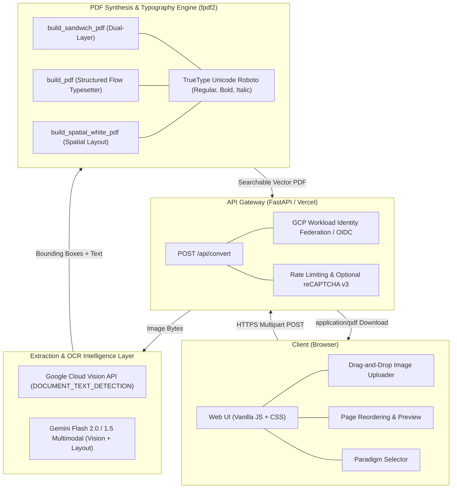
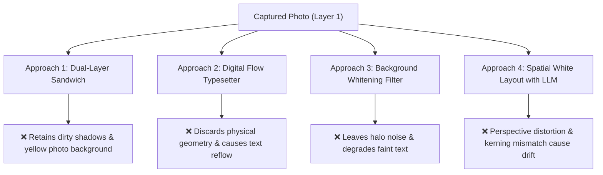

# 🏛️ Architecture & Document Digitization Wiki

**Document Version:** 1.0.0  
**Last Updated:** October 2026  
**Repository:** [image-to-pdf](https://github.com/pttd96/image-to-pdf)  
**Status:** Architecture Reference & Research Synthesis  

---

## 1. Executive Summary & Problem Statement

The goal of **Image to PDF** is to transform everyday smartphone camera photos of physical documents (books, legal contracts, administrative forms, receipts) into clean, professional, and fully searchable multi-page PDFs.

### The Real-World Challenge
Smartphone photos of physical documents present severe optical and physical challenges:
- **Lighting & Paper Degradation:** Uneven room lighting, phone shadows, flash glare, yellowed or translucent paper bleed-through.
- **Geometric Distortion:** Angled camera perspective (trapezoidal skew), lens barrel distortion, and cylindrical page curvature near book spines.
- **Typographic Diversity:** Mixed content including centered titles, right-aligned dates and signature blocks, multi-column tables, indented paragraphs, and accented Vietnamese diacritics.

This wiki documents the overall system architecture, details the **four distinct digitization paradigms** tested during research, provides root-cause analysis of why each fell short of user expectations, and outlines the recommended roadmap for future iterations.

---

## 2. High-Level System Architecture



### Core Technology Stack

| Layer | Technology | Role & Rationale |
|---|---|---|
| **Backend Runtime** | Python 3.11+, FastAPI | Asynchronous request handling, serverless deployment on Vercel and Cloud Run. |
| **Authentication** | Google Cloud Workload Identity Federation | Keyless, secure token exchange using Vercel OIDC (`x-vercel-oidc-token`). Fallback to JSON Service Account for local dev. |
| **OCR Engine** | Google Cloud Vision API (`DOCUMENT_TEXT_DETECTION`) | Pixel-accurate bounding boxes for word tokens, character confidence, and dense document OCR. |
| **Document Vision LLM** | Google Gemini Flash (`gemini-2.0-flash`, `gemini-1.5-flash`) | Multimodal layout recognition, semantic block structuring, table extraction, and Vietnamese copyediting. |
| **PDF Synthesis** | `fpdf2` | Lightweight, pure Python vector PDF generator with TrueType Unicode support, table grids, and invisible text modes. |
| **Image Preprocessing** | Pillow (PIL) | Dynamic range stretching, contrast enhancement, Gaussian illumination compensation. |

---

## 3. Deep-Dive: The 4 Digitization Approaches Evaluated

During development, four distinct architectural paradigms were implemented and evaluated against real-world camera captures.



---

### Approach 1: Dual-Layer Sandwich PDF (Adobe Scan / Apple Notes Paradigm)

Implemented in branch `feature/sandwich-pdf`.

#### Mechanism:
- **Layer 1 (Visible Background):** The original high-resolution photo scaled to standard A4/Letter dimensions.
- **Layer 2 (Invisible Text Overlay):** Extracted OCR word tokens rendered using PDF invisible text mode (`TextMode.INVISIBLE` / `3 Tr`) at exact pixel-scaled coordinates `(x, y, w, h)`.

```
┌────────────────────────────────────────────────────────┐
│ Layer 2: Invisible Searchable Text Layer (TextMode=3 Tr)│
│          [HỢP] [ĐỒNG] [LAO] [ĐỘNG]                     │
├────────────────────────────────────────────────────────┤
│ Layer 1: High-Res Original Photo (Full Visual Fidelity)│
│          (Shows exact paper, print fonts, stamps)      │
└────────────────────────────────────────────────────────┘
```

#### Evaluation:
- **Strengths:**
  - 100% visual authenticity: preserves original print fonts, signatures, official red rubber stamps, handwritten notes, and exact table grid lines.
  - Fully searchable (`Cmd+F` / `Ctrl+F`) and copy-pasteable with precise word highlight matching.
- **Why It Failed User Requirements:**
  - The user explicitly did **not** want a camera photo. Physical shadows, yellowed paper, uneven room lighting, and dirty backgrounds remained fully visible. The output felt like a "photograph" rather than a clean, newly digitized document.

---

### Approach 2: Pure Digital Typesetter (Reflowed Semantic Markdown Blocks)

Implemented in branch `feature/markdown-digital-typesetter`.

#### Mechanism:
- Gemini Flash multimodal analyzes the photo and decomposes the document into high-level semantic Pydantic blocks: `HeadingBlock`, `ParagraphBlock`, `ListBlock`, `QuoteBlock`, `TableBlock`, and `KeyValueBlock`.
- `fpdf2` renders the blocks into a freshly formatted digital document on a `#FFFFFF` page using `Roboto` TrueType fonts, native table grids, and paragraph margins.

```
┌────────────────────────────────────────────────────────┐
│ Pure Digital Canvas (#FFFFFF)                          │
│                                                        │
│             CỘNG HÒA XÃ HỘI CHỦ NGHĨA VIỆT NAM         │
│                 Độc lập - Tự do - Hạnh phúc            │
│                                                        │
│ 1.1 Khái niệm chung                                    │
│    Nội dung văn bản được định dạng lại hoàn toàn...    │
│                                                        │
│ [Table: Cột 1 | Cột 2 | Cột 3]                         │
└────────────────────────────────────────────────────────┘
```

#### Evaluation:
- **Strengths:**
  - Pristine vector white background with crisp typography.
  - Native tables with alternating row shading and clean borders.
  - Tiny PDF file size (vector text only, no raster images).
- **Why It Failed User Requirements:**
  - Completely discards the physical spatial layout of the original document.
  - Physical books and contracts have carefully calibrated column widths and line breaks. Flow reflow caused sentences to break arbitrarily, destroying the visual cadence, indentation, and page balance of the source book.

---

### Approach 3: Background Whitening Filter (Pillow Illumination Division)

Implemented in branch `feature/whitened-sandwich-nlp`.

#### Mechanism:
- Applies illumination compensation to the raster photo prior to sandwich PDF assembly:
  1. A large-radius Gaussian blur (`min(w, h) / 60`) estimates the background illumination gradient.
  2. Subtraction isolates dark ink: `ink_delta = ImageChops.subtract(blurred_bg, channel)`.
  3. Inversion produces dark ink on white paper: `inv = ImageChops.invert(ink_delta)`.
  4. Dynamic range stretching (`ImageOps.autocontrast(cutoff=1)`) locks background pixels to `#FFFFFF`.

```
Photo RGB ──► Gaussian Blur (Estimate BG) ──► Subtract ──► Invert ──► Autocontrast ──► Whitened Photo
```

#### Evaluation:
- **Strengths:**
  - Removes global shadow gradients without altering layout.
- **Why It Failed User Requirements:**
  - Real-world smartphone lighting (flash hot-spots, dark room corners) does not conform to uniform illumination division.
  - Dark text developed visible halo artifacts; faint punctuation, watermarks, and subtle Vietnamese diacritics (`.`, `,`, `?`, `~`) were washed out or degraded.
  - The background remained a compressed raster bitmap rather than a true digital canvas.

---

### Approach 4: Spatial Pure White Layout with LLM Multimodal Alignment

Implemented in branch `feature/whitened-sandwich-nlp` (Milestone 4).

#### Mechanism:
- Completely removes the photo background and renders onto a pristine `#FFFFFF` digital vector canvas.
- Passes the original photo (Layer 1) to Gemini Flash 2.0 with a typographic alignment prompt:
  - Detects semantic alignment: `center` (titles, mottos), `right` (dates, signatures), `left` / `justify` (body paragraphs).
  - Levels horizontal baselines (`ymin`, `ymax` in `box_2d`) to remove camera tilt staircasing.
  - Identifies paragraph first-line indents (`is_paragraph_start: true`).
  - Proofreads Vietnamese diacritics and OCR typos directly against visible image ink.
- `fpdf2` positions TrueType vector text at calculated spatial coordinates.

#### Evaluation:
- **Strengths:**
  - Pristine `#FFFFFF` vector white canvas with crisp vector typography.
  - Centered titles snap to page center; signature blocks snap to right margin.
  - Vietnamese diacritics and OCR typos corrected by Gemini Flash.
- **Why It Still Failed User Expectations:**
  1. **Non-Linear Perspective & Page Curvature:** When a book or page is photographed, the paper curves near the binding and the camera lens creates trapezoidal perspective. A single leveled bounding box cannot account for 3D barrel or page curvature.
  2. **Font Kerning Mismatch:** Digital `Roboto` has different character widths and proportional kerning compared to commercial book print fonts (e.g. Minion, Times, Garamond). Placing clustered lines at physical coordinates caused text either to run short or to overflow document margins.
  3. **LLM Coordinate Granularity:** 2D bounding boxes normalized to `1000x1000` lack the sub-pixel precision required for seamless typographic alignment across 40+ dense lines per page.

---

## 4. Comprehensive Comparison Matrix

| Evaluation Dimension | Approach 1: Dual-Layer Sandwich | Approach 2: Flow Typesetter | Approach 3: Whitened Filter | Approach 4: Spatial White Layout |
|---|---|---|---|---|
| **Background Appearance** | Photo (shadowed, yellow) | Pristine `#FFFFFF` vector | Filtered photo (halos/noise) | Pristine `#FFFFFF` vector |
| **Typography** | Original print font (raster) | Roboto vector (reflowed) | Original print font (filtered) | Roboto vector (positioned) |
| **Layout Fidelity** | 100% exact copy | Discarded (flow layout) | 100% exact copy | Approximated spatial |
| **Searchability (Cmd+F)** | 100% word-accurate | Full-text searchable | 100% word-accurate | Line/word searchable |
| **Handwriting & Stamps** | Fully preserved | Omitted / lost | Preserved (faded) | Omitted (text only) |
| **Resilience to Tilt / Skew** | N/A (photo stays tilted) | High (straightened flow) | N/A (photo stays tilted) | Moderate (LLM leveled) |
| **Resilience to Spine Curve** | High (visual match) | High (curved ink ignored) | High (visual match) | Low (curved baselines drift) |
| **File Size** | Medium (~1-3 MB / page) | Very Small (~30-80 KB) | Medium (~1-2 MB / page) | Small (~100-250 KB) |
| **API Cost / Latency** | Low / 1-2s (Vision only) | Moderate / 2-3s (Gemini) | Low / 1-2s (Vision only) | Moderate / 2-4s (Gemini) |

---

## 5. Architectural Lessons Learned & Future Roadmap

When revisiting this problem, future development should focus on the following technical directions:

### 1. Computer Vision Page Dewarping & Perspective Rectification (Prerequisite Step)
Before attempting any text extraction or layout alignment, raw camera captures must undergo **geometric rectification**:
- **Document Corner Detection:** Use OpenCV contour detection or deep edge models to detect the 4 physical document corners.
- **Perspective Homography Transform:** Warp the quadrangular document into a flat, frontal rectangular plane.
- **3D Surface Dewarping:** For curved book pages, evaluate specialized dewarping models (e.g. DocTr, UVDoc, or PageMerge) to flatten cylinder curvature before OCR.

### 2. Hybrid Vector-Raster Segmentation
Documents often contain non-text graphical elements that cannot be represented by fonts:
- Separate the document into:
  - **Text layer:** Digitally typeset into pure vector font.
  - **Asset layer:** Crop stamps, signatures, company logos, and diagrams as transparent PNG cutouts and composite them onto the vector canvas at exact spatial locations.

### 3. Font Metric Matching & Micro-Tracking
To prevent text overflow or drift when replacing print fonts with digital fonts:
- Dynamically calculate line width ratios between OCR bounding boxes and digital font metrics.
- Apply subtle character spacing (letter-spacing / micro-tracking) or dynamic font scaling per line to match the source document's line bounds exactly.

---

## 6. Repository Branch Cleanup & Maintenance

As of October 2026, experimental testing branches have been decommissioned:
- `feature/sandwich-pdf`
- `feature/markdown-digital-typesetter`
- `feature/whitened-sandwich-nlp`

All stable production logic is consolidated on `main`. Future experiments should branch from `main` using the geometric dewarping roadmap outlined above.
